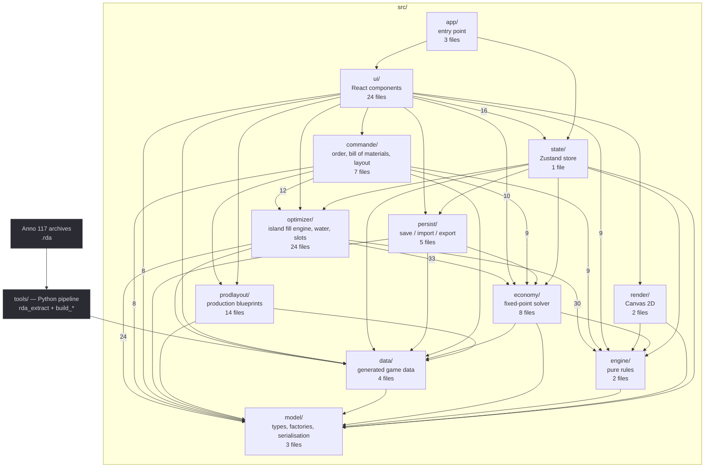

# Anno 117 Designer

[](https://github.com/MaissaRemi/anno117-designer/actions/workflows/ci.yml)

A web tool to plan and optimise building layouts for **Anno 117: Pax Romana** — running on the game's real data, extracted straight from its own archives.

> ⚠️ **Work in progress — not validated yet.**
> The tool runs end to end, but its output has not been verified against the game: layouts it
> produces have not been rebuilt in-game to confirm they are legal and behave as predicted, and
> building footprints are read from `.ifo` bounding boxes with a ±1 tile margin of error.
> Treat it as a planning aid and a technical exercise, not as a reference for optimal builds.

---

## Why this exists

In Anno, every building comes with strings attached. It needs road access. It projects an influence radius that has to cover the right neighbours. Farms need a connected field of an exact size. And the island you are building on has an irregular coastline that refuses to cooperate.

Planning a district that satisfies all of that at once is a genuinely interesting packing problem. Solving it *inside* the game is not: you place, you check, you tear down, you place again.

So I moved the problem outside the game — and set myself one rule that shaped everything after it: **no hand-typed numbers**. Not values copied off a wiki, not approximations. The actual figures Ubisoft ships in the game files. Which meant that before writing a single line of the editor, I had to be able to read Anno's archives.

That constraint turned a layout tool into three problems worth solving.

## Three problems worth solving

**Reading an undocumented binary format.** Anno stores its data in `.rda` archives — *Resource File V2.2*. A 792-byte header, a file directory that lives *before* the block header pointing at it, zlib-compressed payloads, UTF-16LE paths in 560-byte records. There is no official spec. [`tools/rda_extract.py`](tools/rda_extract.py) is a from-scratch implementation, and it is the foundation everything else stands on.

**Modelling an economy that feeds itself.** Population consumes goods; producing those goods costs workforce; workforce comes from population. It is a circular dependency, so it cannot be computed in one pass. The population planner resolves it as a **fixed-point iteration** — population → needs → production → workforce → more population → … — with a convergence guarantee that hinges on one detail: `NeedConsumptionRate` is defined *per house*, not per inhabitant. Get that wrong and the cascade diverges. There is a fallback and a warning if it ever does.

**Laying out a city that works.** You say what you want — so many houses of a tier, these production chains — and the planner turns it into the exact list of buildings, then lays them out: houses in a regular **grid of blocks**, services placed where they cover the most houses along the streets, alleys left free for the aqueducts, production chains packed into compact blueprints around the city, mines on the island's real mountain slots, everything wired to the trading post. Every copy of a service has to pay for the ground it takes; every plan reports, line by line, what was asked and what was built. It runs in a **Web Worker** so the interface never freezes.

## What it does

- **Real building catalogue** — 338 buildings with their true dimensions, rotation, road requirement, radius, field size, production chain and region. Searchable, filterable, and editable in-app.
- **Real islands** — load any of the **55 islands** in the game at its exact size and coastline shape.
- **Free-form grid** — or paint your own buildable area.
- **Placement with live validation** — valid/invalid preview, rotation, moving, locking. Broken rules are outlined in red and explained in the side panel.
- **Roads and fields** painted by hand, checked against the real rules: road adjacency, field size, connectivity and contact with its building.
- **Influence radii** drawn as overlays.
- **Order planner (📋 Commande)** — order houses per tier, a service recipe and production buildings; get a live bill of materials, then a full island layout that says what was served and what was not.
- **Fill an island (🏛 Remplir l'île)** — the original engine: pack the most inhabitants of a tier onto the island.
- **Production blueprints (🏭 Production)** — the smallest working layout for a production chain, ready to copy.
- **Persistence** — browser autosave, JSON import/export, PNG export.

---

## Installation

The extracted game data is committed, so the catalogue, the islands and the economy all work out of the box — no game installation needed just to try the tool.

Building icons are the one exception, see [below](#icons-are-not-bundled). Without them the interface falls back to a coloured tile per building; everything else behaves normally.

### With Docker

Nothing to install but Docker itself.

```bash
git clone https://github.com/MaissaRemi/anno117-designer.git
cd anno117-designer
docker compose up
```

Open **http://localhost:8080**.

The image is a multi-stage build: `node:20-alpine` compiles and type-checks, then only the static bundle is copied into `nginx:alpine`. The final image carries no toolchain and no source.

For hot reload while developing:

```bash
docker compose --profile dev up dev     # http://localhost:5173
```

### With Node

```bash
git clone https://github.com/MaissaRemi/anno117-designer.git
cd anno117-designer
pnpm install
pnpm dev          # http://localhost:5173
```

Requires **Node.js 18+**.

### Other commands

```bash
pnpm build        # type-check then production build into dist/
pnpm test             # unit tests for the rule engine and the optimiser
pnpm lint
pnpm typecheck
```

The same four steps run on every push and pull request through GitHub Actions — see [`.github/workflows/ci.yml`](.github/workflows/ci.yml).

### Regenerate the game data (optional)

```bash
pip install -r tools/requirements.txt
export ANNO_GAME_DIR="<...>/Anno 117 - Pax Romana/maindata"   # Windows: set ANNO_GAME_DIR=...
python tools/extract_icons.py
```

---

## The game data pipeline

Nothing in this tool is hard-coded. All 338 buildings, 55 islands, production chains and terrain heights are produced by an extraction pipeline that reads the game's archives directly. When the game gets patched, you re-run the pipeline.

### Icons are not bundled

The 222 building icons are Ubisoft artwork. They are **not committed** — `public/icons/` is gitignored — and they are not redistributed here. Run `python tools/extract_icons.py` against your own installation to generate them.

### Full regeneration

```bash
export ANNO_GAME_DIR="<...>/Anno 117 - Pax Romana/maindata"

python tools/rda_extract.py get "$ANNO_GAME_DIR/config.rda" data/base/config/export/assets.xml   .gamedata/assets_base.xml
python tools/rda_extract.py get "$ANNO_GAME_DIR/config.rda" data/base/config/gui/texts_french.xml .gamedata/texts_french.xml

python tools/build_catalog.py     # -> src/data/catalog.generated.json
python tools/build_economy.py     # -> src/data/economy.generated.json
python tools/build_islands.py     # -> src/data/islands.generated.json
python tools/build_terrain.py     # -> src/data/terrain*.generated.json
python tools/extract_icons.py     # -> public/icons/*.png   (not committed)
```

| Script | Role |
|---|---|
| `rda_extract.py` | RDA "Resource File V2.2" archive extractor |
| `build_catalog.py` | `assets.xml` + localised text + sizes (`.ifo` BoundingBox) → catalogue |
| `build_economy.py` | Needs, production chains, workforce |
| `build_islands.py` | Sizes and land/sea masks for the 55 islands |
| `build_terrain.py` | Relief and heightmaps |
| `extract_icons.py` | Building icons, 4K DDS → 64px PNG |

**Exact**: roads, radii, fields, production, names. **±1 tile**: building sizes, read from `.ifo` bounding boxes — correctable in the in-app catalogue editor.

---

## Order planner

Load an island, open **📋 Commande**, and say what you want.

- **The order** — houses per tier, a service recipe (minimal ground, or every service for more inhabitants per house), anti-incident institutions, production buildings picked by name, whether to complete their chains, whether the houses' goods are imported or produced on the island, and whether missing workforce gets worker houses or is only reported.
- **The bill of materials** — recomputed on every keystroke (`src/commande/nomenclature.ts`): every building with the reason it is there, the tier each line actually reaches, the goods and their source, the workforce balance, the ground it will take. Worker tiers get the services *their* thresholds require; a good no building of this world produces is imported instead of pulling a chain from the other world.
- **The layout** — `src/commande/ilots.ts` builds the city as a grid of 12 × 6 blocks of eight houses, roads above and below, every other column left as a free alley for the aqueducts. Services replace blocks where they cover the most houses not yet covered, at a price that counts their footprint, the ground they waste and the water they draw. The city is centred on the fullest part of the island within aqueduct reach of a mountain, and grows only through blocks whose roads join it. `src/commande/production.ts` then places the production around it: chains grouped by the goods they exchange, split in two whenever one warehouse cannot serve them all, each blueprint dropped in the nearest free box and wired to the network; mines and clay pits on the real slots; fishers on the coast.
- **The report** — served or not, what is missing and by how much, the attribute balance per house (as a risk, not a reason to demolish), the ground used. **Place on island** hands the plan to the editor.

Measured on the game's islands: 300 Patricians fully served on five islands out of eight in about 7 300 tiles, 37 % of them houses and 15 % roads; 500 on three large islands out of four. Small, cut-up islands and single cities above ~500 houses are the known limits — the report says so, in numbers.

Data: `tools/build_economy.py` → `src/data/economy.generated.json`. Solver: `src/economy/`. The full design and every measurement: [`docs/superpowers/plans/2026-10-26-refonte-moteur-ile.md`](docs/superpowers/plans/2026-10-26-refonte-moteur-ile.md).

## Real island shapes

Press **🏝 Island** to load one of the game's 55 islands as your grid.

- Grid size read from each island's `.a7minfo` (width and height at offset 8).
- Shape derived from the land/sea mask of the rendered `mapimage.png`, resampled to the real grid size and stored RLE-encoded.
- Thumbnails in the picker; loading an island replaces the current grid.

## Fill an island

The original engine, still available as **🏛 Remplir l'île**: pick a tier and it packs as many inhabitants as it can, choosing the services itself. Roads come from a fixed comb, services are laid as a lattice over the whole island, houses fill the rest; water is routed during placement.

The island's attribute balance is **reported, not enforced** by default. An earlier "viability guard" demolished up to nine houses in ten to keep the island's total attributes above zero — a rule never checked against the game — and left the services and roads behind. It is still available as an option (*Respecter strictement le bilan d'attributs*).

Code: `src/optimizer/` (`islandPlan`, `planLattice`, `waterPlan`, `slotPlan`, `kontor`). The *production* archetype of this tab still uses the greedy decoder and simulated annealing (`greedy`, `anneal`, `prodPlan`).

## Keyboard shortcuts

| Key | Action |
|---|---|
| `R` | Rotate the pending placement, or the selected building |
| `Del` | Delete the selected building |
| `Ctrl+Z` / `Ctrl+Y` | Undo / redo |
| `Esc` | Deselect |
| Wheel | Zoom · right-click drag to pan |

## Architecture

The diagram below is **generated from the real imports** by
[`tools/gen_architecture_diagram.py`](tools/gen_architecture_diagram.py), so it cannot drift away
from the code. Re-run it after any refactor:

```bash
python tools/gen_architecture_diagram.py
```

<!-- ARCHITECTURE:START -->



<!-- ARCHITECTURE:END -->

The rule engine is deliberately kept as **pure functions with no React dependency**, and so are the order planner and the blueprints. That is what makes them testable — **over 440 tests** cover geometry, placement rules, the economy solver, the layout engines and the invariants every plan must keep (no overlap, nothing off the island, everything reachable from the trading post) — and what lets the planners reuse the exact same rules as the live editor.

---

## Where it stands

What works: the extraction pipeline, the rule engine, the editor, the order planner, the production blueprints, the island fill engine, and the Docker build — with the measurements in the redesign plan linked above.

What is missing before this can be called finished:

- **In-game validation** — no layout has been rebuilt in Anno 117 yet. Four checks matter most: what a negative attribute balance really does to a city, what a tier's `UpgradeThreshold` means, whether goods are consumed per house or per inhabitant, and how far an aqueduct carries on flat ground (`.claude/GAME_MECHANICS.md`, §13).
- **Exact footprints** — sizes come from `.ifo` bounding boxes and are accurate to ±1 tile. They are editable in-app, but they are not yet correct by default for every building.
- **Deposits** — which ore a mountain holds is not in the extracted data: a gold mine may land on an iron mountain.

The planners are tested against themselves and against the game's data, not against the game. That distinction matters, and it is the main reason this is still marked as in progress.

## Legal notice

Unofficial personal project, **not affiliated with Ubisoft** in any way. *Anno* is a registered trademark of Ubisoft Entertainment.

The game data used by this tool is extracted from a local installation and remains the property of Ubisoft. Building icons are not redistributed: generate them from your own files with `tools/extract_icons.py`. A legal copy of Anno 117 is required to run the extraction pipeline.
